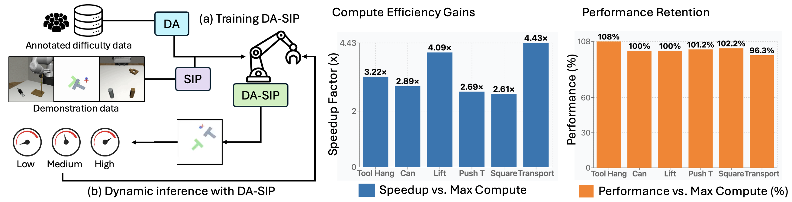
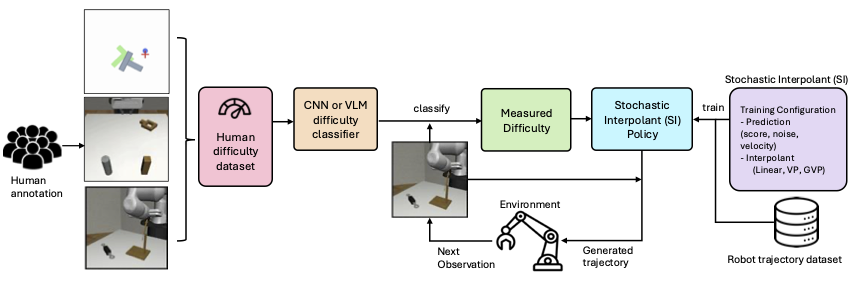

# DASIP: Difficulty-Aware Stochastic Interpolant Policy

**Dynamic Test-Time Compute Scaling in Control Policy via Adaptive Solver Configuration.**

[NeurIPS 2025] Official implementation of **DASIP**, a framework that unifies diffusion and flow-matching policies to enable adaptive computation.

[](https://arxiv.org/abs/2511.20906)
[](LICENSE)

**Authors:** Inkook Chun†, Seungjae Lee‡, Michael S. Albergo⋄, Saining Xie†, Eric Vanden-Eijnden†,§

†New York University, ‡University of Maryland, ⋄Harvard University, §Capital Fund Management

## Overview



Standard generative policies (diffusion or flow-based) employ a fixed inference budget for every control step, wasting resources on simple subtasks while potentially underperforming on hard ones.

**DASIP** introduces a **Stochastic Interpolant (SI)** framework that unifies ODE (Flow) and SDE (Diffusion) formulations. It uses a lightweight **difficulty classifier** to analyze observations in real-time and dynamically selects an optimal **Inference Configuration Triple**:

$$\langle \text{Step Count}, \text{Solver Type}, \text{ODE/SDE Integration} \rangle$$

This is analogous to "System 1 vs. System 2" thinking in cognitive science—fast, intuitive processing for easy states and deliberate, effortful computation for hard states.

## Key Idea

| Difficulty Category | Context Example | Compute Strategy | Configuration (Steps, Solver, Mode) |
|:---|:---|:---|:---|
| **Initial (I)** | Robot positioned away from targets | Minimal | 1, Euler, ODE |
| **Near (N)** | Approaching near object | Low | 5, Euler, ODE |
| **Grabbing (G)** | Grasping and placing objects | Medium | 10, Euler, ODE |
| **Stochastic (S)** | Precision alignment (e.g., Tool Hang) | High (Exploration) | 50, Euler, SDE |
| **Continuous (C)** | Sustained precise manipulation (e.g., Push) | Max (Precision) | 100, Heun, SDE |
| **End (E)** | Task objectives achieved | Minimal | 1, Euler, ODE |

This approach achieves **2.6–4.4× reduction in computation time** while maintaining or exceeding state-of-the-art success rates.

## Stochastic Interpolant Framework

DASIP is grounded in the **stochastic interpolant (SI) framework**, which unifies flow-based (ODE) and diffusion-based (SDE) generative modeling. This formulation enables:

- **Flexible training configurations:** Choose prediction target (noise, score, velocity) and interpolant type (Linear, VP, GVP)
- **Adaptive inference:** Translate difficulty levels into optimized inference configurations without retraining
- **ODE/SDE switching:** Dynamically select deterministic or stochastic integration based on task requirements

### Supported Configurations

| Training | Options |
|----------|---------|
| Prediction Target | Noise, Score, Velocity |
| Interpolant Type | Linear, VP (Variance Preserving), GVP (Generalized VP) |

| Inference | Options |
|-----------|---------|
| Integration Mode | ODE (deterministic), SDE (stochastic) |
| Solver Type | Euler, Heun |
| Step Count | 1–100 (adaptive based on difficulty) |

## Difficulty Classifiers

DASIP supports three classifier architectures:

| Classifier | Description | Use Case |
|------------|-------------|----------|
| **Lightweight CNN** | Trained on 32×32 images (~300 samples/task), 0.023s inference | Default, production |
| **Few-shot VLM** | Vision-language model with exemplar prompts | Zero-shot transfer |
| **Fine-tuned VLM** | Qwen-VL fine-tuned on difficulty annotations | Highest accuracy |

## Quick Start

```bash
# 1. Install
conda env create -f SIP/conda_environment.yaml
conda activate SI_policy
cd SIP && pip install -e . && cd ..

# 2. Download data (Annotated Difficulty Data + Robomimic/PushT)
python scripts/download_data.py --all

# 3. Train Difficulty Classifier (Lightweight CNN)
python scripts/classifiers/train_cnn.py --env square --data_path flow_label/data/

# 4. Train Stochastic Interpolant (SI) Policy
./scripts/run_train.sh --env square --save_path my_si_policy --path_type Linear --num_epochs 5000

# 5. Run DASIP Adaptive Inference
./scripts/run_dasip.sh --env square --checkpoint my_si_policy --compare_baseline
```

## Project Structure

```
DASIP/
├── README.md
├── assets/                     # Documentation assets
│   ├── intro.png               # Overview figure
│   ├── DASIP poster.png        # Project poster
│   └── overview.png            # Architecture diagram
├── scripts/
│   ├── download_data.py        # Download datasets and models
│   ├── train.py                # Train SI policy
│   ├── dasip_infer.py          # DASIP adaptive inference
│   ├── evaluate.py             # Standard evaluation
│   ├── infer_with_seeds.py     # Multi-seed inference
│   ├── process_results.py      # Result processing
│   ├── run_train.sh            # Training shell wrapper
│   ├── run_dasip.sh            # DASIP inference wrapper
│   └── classifiers/            # Difficulty Classifiers
│       ├── train_cnn.py        # Lightweight CNN (Recommended)
│       ├── vlm_finetune.py     # Fine-tuned VLM (High Accuracy)
│       ├── vlm_fewshot.py      # Few-shot VLM
│       └── models/             # VLM wrappers
├── SIP/                        # Core Implementation
│   ├── SI_policy/              # Stochastic Interpolant Models
│   │   ├── config/             # Hydra configs
│   │   ├── model/              # Neural networks (U-Net transformer)
│   │   ├── policy/             # Unified ODE/SDE policies
│   │   └── env_runner/         # Environment runners
│   └── data/                   # Data directory
│       ├── pusht/              # PushT dataset
│       ├── robomimic/          # Robomimic datasets
│       ├── checkpoints/        # Trained SIP models
│       └── classifiers/        # Trained classifiers
└── flow_label/                 # Difficulty annotation data
    └── data/
```

## Complete Pipeline

### Step 1: Download Data

Download the annotated difficulty datasets (~20k labeled states from 8 annotators) and standard benchmarks.

```bash
# Download all data (datasets + classifiers)
python scripts/download_data.py --all

# Or download selectively
python scripts/download_data.py --datasets              # Training datasets
python scripts/download_data.py --datasets --tasks pusht square  # Specific tasks
python scripts/download_data.py --classifiers           # Classifier models
```

### Step 2: Train Difficulty Classifier

We support three difficulty classifier variants:

1. **Lightweight CNN:** (Recommended) Trained on ~300 images per task (32×32 input). Fast inference (~23ms).
2. **Fine-tuned VLM:** (High Accuracy) Qwen2.5-VL fine-tuned for 8 epochs.
3. **Few-shot VLM:** Multi-image prompting with 1-3 exemplars per category.

#### Lightweight CNN (Recommended)

```bash
python scripts/classifiers/train_cnn.py \
    --data_path flow_label/data/annotations.csv \
    --output_dir SIP/data/classifiers \
    --env square
```

#### VLM Fine-tuning

For high-accuracy vision-language classification:

```bash
python scripts/classifiers/vlm_finetune.py \
    --train_envs can square tool_hang transport \
    --test_env lift \
    --epochs 8
```

See `scripts/classifiers/README.md` for details.

### Step 3: Train Stochastic Interpolant Policy

Train a single generative policy capable of both ODE and SDE integration. The **Stochastic Interpolant** framework allows selecting the path type (Linear, VP, GVP) at training time.

```bash
# Train with Linear Interpolant (Flow Matching equivalent)
./scripts/run_train.sh \
    --env square \
    --save_path v1_square_Linear \
    --path_type Linear \
    --num_epochs 5000

# Train with VP Interpolant (Diffusion equivalent)
./scripts/run_train.sh \
    --env square \
    --save_path v1_square_VP \
    --path_type VP \
    --num_epochs 5000

# Train with GVP (Generalized VP) interpolant
./scripts/run_train.sh \
    --env square \
    --save_path v1_square_GVP \
    --path_type GVP \
    --num_epochs 5000

# Training options
./scripts/run_train.sh --help
```

### Step 4: Run DASIP Inference

During inference, the policy adapts the **Step Count**, **Solver**, and **Integration Mode** based on the predicted difficulty.

```bash
# Run adaptive inference (Auto-configures steps based on difficulty)
./scripts/run_dasip.sh \
    --env square \
    --checkpoint v1_square_Linear \
    --classifier_path SIP/data/classifiers/square_cnn.pth

# Compare with fixed-budget baseline (Max Compute)
./scripts/run_dasip.sh \
    --env square \
    --checkpoint v1_square_Linear \
    --compare_baseline

# Save results to JSON
./scripts/run_dasip.sh \
    --env square \
    --checkpoint v1_square_Linear \
    --compare_baseline \
    --output results.json
```

### Step 5: Process Results

```bash
# Generate CSV summary from evaluation logs
python scripts/process_results.py \
    --input_dir SIP/outputs \
    --output results.csv
```

## Manual Data Download

If automatic download fails:

| Data | URL | Destination |
|------|-----|-------------|
| PushT | [download](https://diffusion-policy.cs.columbia.edu/data/training/pusht.zip) | `SIP/data/` |
| Robomimic | [download](https://diffusion-policy.cs.columbia.edu/data/training/robomimic.zip) | `SIP/data/` |
| Flow Label | [Dropbox](https://www.dropbox.com/scl/fi/y72ccuu6lv3sdztqau0a3/data-flow-label.zip?rlkey=buxwsuhs7n1ccm27h9uhc46qv&dl=0) | `flow_label/` |

```bash
# Example manual download
wget -O pusht.zip "https://diffusion-policy.cs.columbia.edu/data/training/pusht.zip"
unzip pusht.zip -d SIP/data/

wget -O flow_label.zip "https://www.dropbox.com/scl/fi/y72ccuu6lv3sdztqau0a3/data-flow-label.zip?rlkey=buxwsuhs7n1ccm27h9uhc46qv&dl=1"
unzip flow_label.zip -d flow_label/
```

## Troubleshooting

### Classifier not found
```
Warning: Classifier not found at SIP/data/classifiers/square_cnn.pth
```
**Solution:** Train the classifier first:
```bash
python scripts/classifiers/train_cnn.py --env square
```

### Checkpoint not found
```
FileNotFoundError: Checkpoint not found: my_checkpoint
```
**Solution:** Check the path exists in `SIP/outputs/` or use full path.

### CUDA out of memory
**Solution:** Reduce batch size:
```bash
./scripts/run_train.sh --env square --batch_size 128
```

## Resources

### Poster


### Architecture Overview



## Citation

If you use DASIP in your research, please cite our NeurIPS 2025 paper:

```bibtex
@inproceedings{chun2025dasip,
  title={Dynamic Test-Time Compute Scaling in Control Policy: Difficulty-Aware Stochastic Interpolant Policy},
  author={Chun, Inkook and Lee, Seungjae and Albergo, Michael S. and Xie, Saining and Vanden-Eijnden, Eric},
  booktitle={Advances in Neural Information Processing Systems (NeurIPS)},
  year={2025}
}
```

## Acknowledgments

We thank the authors of Stochastic Interpolant, SiT, and Diffusion Policy for their foundational codebases. We appreciate the valuable discussions and feedback from Sanghyun Woo, Nur Muhammad Mahi Shafiullah, Lerrel Pinto, and Mark Goldstein. This work was supported by NYU IT High Performance Computing resources.